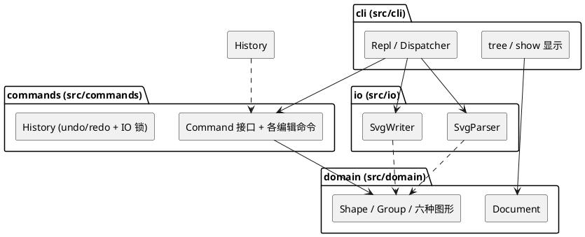

# Lab1 Phase 1：SVG 编辑器（CLI）— 设计文档

> **Git 仓库**：<https://github.com/SchwarzDY/software_dev_pj>（最终提交打有 `final` 标签，工程根目录为 `lab1/`）
> **运行方式**：`lab1/` 目录下执行 `npm install && npm run cli`；测试：`npm test`（42 例）。

## 架构方案

### 1. 模块划分

代码分为四个模块（`src/` 下四个目录），每个模块一类一文件：

| 模块 | 目录 | 职责 |
|---|---|---|
| 领域模型 | `src/domain/` | 内存中的图形树。`Shape` 抽象类统一叶子图形（rect / circle / ellipse / line / text）与容器 `Group`（Composite）；`Document` 持有画布尺寸、根容器与 id → 图形索引。几何语义（move 增量平移、scale 全几何等比、set 属性白名单校验）在这一层实现；图形级的序列化（`toSvg()`）与 tree 显示行（`summary()`）是图形自身的多态方法（理由见"变化点 1"）。 |
| 命令层 | `src/commands/` | 每条编辑命令是一个 `Command` 对象（`execute()` / `undo()`，返回值即回显文案）；`History` 维护 undo / redo 双栈与 IO 锁（文档类命令后禁止撤销，直至下一条编辑命令）。 |
| 文件读写 | `src/io/` | 文档级 XML 处理：`SvgParser` 把 SVG 文本解析成 domain 对象（缺 id 自动补号并警告），`SvgWriter` 负责文档头、嵌套与缩进、写文件。图形级序列化由图形多态方法提供，io 只做组装。 |
| 命令行界面 | `src/cli/` | REPL：逐行读取、分词（双引号参数、`#` 注释）、命令名 → 命令对象的分发、tree / show / help 显示、退出。是唯一接触终端的模块。 |

PlantUML 组件图：



### 2. 设计模式的选择

**Command（作业要求采用）**——"一条编辑命令 = 一个 undo 单元"天然适合命令模式：

- 接口 `Command { execute(): string; undo(): string }`，返回值即回显文案（如 `circle#c1 moved to (130,100)`），保证反馈与操作同源、undo 时能打印"还原到哪"；
- 每个命令对象自持逆操作所需信息（如 MoveCommand 记录目标 id 与增量），undo 无需全文档快照；
- 命令的**原子性**（"失败不改变任何状态"）在 execute 内先做全部校验、后变更来保证；
- `History` 双栈实现 undo / redo，新编辑后 redo 栈清空；文档类命令（init / read / save / canvas 改尺寸）置 IO 锁，编辑命令成功执行后清锁压栈。

落地：`src/commands/` 下 create / delete / move / scale / set / group / ungroup / addto / front / back 各一个命令类。

**Composite（容器与叶子统一操作）**——`Shape` 为抽象基类，`Group extends Shape` 持子节点列表；`move` / `scale` / `delete` / `set` 对容器递归生效、对叶子直接生效，命令层完全不区分两者。这正是"node2 下移 100 时文字随行"的机制，也是 `in` 子句、`group`、`addto` 三种归属写法共用同一套树操作的基础。

**工厂（名字分派点 ①，标注待重构）**——`create <type>` 的类型名 → 图形构造集中在 ShapeFactory 一处。待重构原因：插件化阶段将改为 ShapeProvider 注册表（box 等插件类型向注册表注册，内核按接口消费，届时内核零改动）。

**命令分发（名字分派点 ②，标注待重构）**——cli 的 Dispatcher 持命令名 → 命令构造的表。待重构原因：未来 agent / GUI 通道可直接构造 Command 对象复用命令层，分发表退化为 CLI 语法糖。

**有意不采用的模式**（记录取舍，避免模式堆砌）：

- **Visitor**：tree / show / 序列化确实需要"按图形类型给出表示"，但用 Shape 上的多态方法即可，且**新增图形类型是本工程最高概率的变化点（box 插件），而 Visitor 恰好对新元素类封闭**（每加一个图形类要改所有 Visitor 接口）——取舍后放弃 Visitor，让图形自己负责表示。
- **Memento**：命令自持逆信息已足够，全文档快照是浪费。
- **Singleton**：Document 由 main 显式创建并注入，无需全局单例。

### 3. 依赖方向规则

```
cli ──▶ commands ──▶ domain
cli ──▶ io ──▶ domain
cli ──▶ domain        （仅 tree/show 读取）
io   ✗ commands       （互不依赖）
domain ──▶ （不依赖任何业务模块）
```

| 规则 | 理由 |
|---|---|
| domain 不依赖任何业务模块 | 领域核心最稳定、被所有人依赖，必须零反向依赖 |
| commands 只依赖 domain | 命令是"对领域的操作"，不该知道文件格式或终端 |
| io 只依赖 domain | 读写是"文件格式 ↔ 领域对象"的翻译，与命令、终端无关 |
| io 与 commands 互不依赖 | 二者只通过 cli 间接协作，避免"读文件直接进历史栈"这类耦合 |
| cli 依赖全部、无人依赖 cli | cli 是最外层、最易替换的通道（未来 agent / 鼠标通道取而代之） |

违反上述规则的 import 即为待处理项（见"一致性自查"）。

### 4. 变化点假设

| # | 变化点（按概率排序） | 留了什么 / 为什么决定不留 |
|---|---|---|
| 1 | **新图形类型**（box 与插件生态，课业已明确预告） | 留：Shape 子类完全自治（自己的创建参数、序列化、tree 显示行），新增类型 = 新增子类 + 工厂一处登记；插件类型自带序列化即可即插即用。**不留** ShapeProvider 插件接口：本阶段只有六种内置类型，抽接口没有第二个实现，属过度设计；插件阶段引入时，工厂是唯一需要改动的位置。 |
| 2 | **新交互通道**（agent API、鼠标 GUI；规范已预告"三种通道"） | 留：命令层完全不接触终端（readline / process 只出现在 cli），GUI 可直接构造 Command 对象复用 undo / redo 全部逻辑。 |
| 3 | **序列化格式扩展**（transform 属性、更多 SVG 特性读回） | 留：文档级 XML 全部隔离在 io；图形级序列化在图形类自身，新增类型不需要改 io。 |
| 4 | **命令集增长** | 留：Command 接口与 History 的契约不变，加命令类即可。 |
| 5 | undo 策略演进（如合并连续 move） | **不留**：History 封装栈语义，外部只见 undo() / redo()，将来要改是内部实现问题；现在没有合并需求的证据。 |

### 补充约定（规格未明处的裁定记录）

规格存在若干未写死之处，实现前裁定如下（讨论背景见过程记录）：

| # | 场景 | 裁定 |
|---|---|---|
| D1 | undo 栈与 IO 锁的关系 | `init` / `read` 替换整个文档：**清空** undo / redo 栈并上锁；`save` / `canvas` 改尺寸只上锁不清栈（旧命令引用的图形对象仍有效）。锁持续到下一条成功执行的编辑命令。 |
| D2 | 读入时自动补 id 的序号 | 按"标签名 + 递增序号"生成，跳过与现存 id 冲突的号码 |
| D3 | 规格未定义退出命令 | 补充 `quit` / `exit`，Ctrl+D 亦可，help 中列出 |
| D4 | `save` 无参数且此前未 read 过文件 | 报 `error: no file specified` |
| D5 | 读入文件含重复 id | 保留首个，其余视为缺 id 自动补号并警告，不中断读入 |
| D6 | 含空格的参数 | 一律双引号包裹（含 `set` 的 text 值） |
| D7 | `group` 新容器的插入位置 | 成员从原父容器摘出后，新 g 插入到**第一个成员**在原父容器中的原位置（保持局部性） |
| D8 | `set` 作用于容器 g | g 无几何属性：白名单仅公共三项 fill / stroke / stroke-width，几何属性报 unknown attribute |
| D9 | `create` 参数个数 / 数字非法 | `error: wrong number of arguments for <type>: expected …, got …`；`error: invalid number: <raw>` |
| D10 | `scale` 作用于 text | 仅 x、y 参与缩放（font-size 不在 set 白名单内，不视为几何属性） |
| D11 | undo / redo 栈空时 | `error: nothing to undo` / `error: nothing to redo` |
| D12 | `ungroup` 作用于非容器 | `error: not a container: <id>`（复用 4.2 既有措辞） |
| D13 | `addto` 把容器移进自身或其子孙（成环） | `error: cannot move a container into its own descendant: <id>` |
| D14 | 规范未定义的回显文案 | set 的文本内容值带引号回显（`text="…"`，与规范示例一致）；其余 undo 回显按"动词过去式 + 还原到哪"自拟（create 的 undo 为 `… removed`、group 为 `… removed, N shapes restored`、ungroup 为 `… ungrouped, N children promoted` / `… restored` 等） |
| D15 | canvas / init 的回显与非法参数 | 修改尺寸回 `canvas set to <W>x<H>`（随后进入 IO 锁）；尺寸非正数报 `error: canvas size must be positive`；参数个数不符统一报 `error: usage: <语法>` |
| D16 | tree 的属性对齐 | 属性列 = 全树最长的「前缀 + 名字」末列 + 2；容器行无摘要不加填充。注：规范 6.1 示例自身列宽不一致（且未显示 line 的 stroke），按统一规则输出；第 5.1 节与第 6 节的两棵树与规范逐字一致 |
| D17 | read 的宽容规则 | 未支持的元素整棵跳过并警告 `warning: skipped unsupported element <tag>`；重复 id 按"缺 id"规则补号并警告；缺失/非法几何属性按 0；画布尺寸缺 width/height 时取 viewBox，仍缺则 800x600 |

---

## 过程记录

**协作模式**：AI（ZCode / GLM 模型）负责通读规格、提出架构方案、编写代码与测试；学生负责逐里程碑黑盒验收（运行 `npm test` 与 `npm run cli` 走查规范会话）、对规格歧义的处置授权、以及对 AI 产出的抽查。全程按里程碑推进、分步提交（M0 脚手架 → M1 架构方案 → M2 领域模型 → M3 命令层 → M4 REPL → M5 I/O → M6 验收 → M7 收尾），共 20 次提交。

有代表性的讨论与迭代如下：

1. **规格歧义的发现与裁定（M1 起，累积 D1–D17）**。AI 通读规格后提出多处未写死之处（undo 栈与 IO 锁的关系、自动补 id 的撞号处理、退出命令缺失、group 的插入位置、read 的宽容规则等）；学生确认无个人倾向、授权按 AI 推荐执行，逐条写入文档裁定表。裁决原则：能沿用规范既有措辞的沿用（如 D12 复用 `not a container`），规范无据时按"与其余规则保持一致"自拟并记录。
2. **测试抓住 AI 的两个连环 bug（M3）**。实现 ungroup 时先注销容器再摘子节点，被提升的子图形全部掉出 id 索引，单元测试当场失败；顺藤摸瓜复查发现 group 的 undo 存在同型隐患（成员仍挂在容器下时注销）。修复后补充回归断言（undo 后元素计数必须还原）。此例确立了"每条命令必须有用例覆盖失败原子性与 undo 往返"的纪律。
3. **AI 输出与规格的逐字差异（M3）**。set 回显初版为 `text=My Diagram v2`，与规范 transcript 的 `text="My Diagram v2"` 差一对引号，被测试比对拦下（D14）。此后所有面向用户的文案一律以规范 transcript 为唯一标准写进断言。
4. **对照规格发现规格自身不一致（M4/M5）**。规范 6.1 的树形输出未显示 line 的 stroke=black，且各示例属性列宽互不一致；AI 提出统一规则（属性列 = 全树最长「前缀 + 名字」末列 + 2），按规则输出后第 5.1 节与第 6 节的树与规范逐字一致，仅 6.1 相差一个空格位，作为已知差异记录（D16）。
5. **解析器参数翻译 bug（M5）**。SvgParser 把 XML 属性翻译为 create 参数的表格，兜底分支误把 `<g>` 当 `<line>` 传参，首次运行测试即暴露，改为显式分支收尾。
6. **类型系统在人机协作中的价值（M2/M3）**。测试初稿把叶子图形当容器传给 `isDescendantOf` 被 TypeScript 当场拦下；UngroupCommand 的判空分支顺序问题也由 strict 模式指出——强类型是协作开发中廉价而有效的防线。
7. **架构取舍（M1）**。是否为 tree / show / 序列化引入 Visitor：因"新增图形类型（box 插件）"是最高概率变化点、而 Visitor 恰对新元素类封闭，最终放弃，改为图形自持表示；Memento、Singleton 亦无需求证据而不采用。理由详见架构方案。

## 一致性自查

### 1. 模块划分：实际目录 vs 方案

实际目录 `src/domain`、`src/commands`、`src/io`、`src/cli`（另有 `tests/`）与方案的四个模块一一对应，无增删。

**修订记录**（与方案 v1 的差异，均非范式违规）：

| # | 差异 | 说明 |
|---|---|---|
| 1 | 工具文件例外 | 方案表述"一类一文件"，实际另有 4 个非类文件：`domain/num.ts`、`domain/xml.ts`（纯函数工具）、`cli/help.ts`（帮助文本函数）、`cli/main.ts`（入口脚本）。修订表述为："类一律一类一文件；少量纯函数工具与入口脚本例外。" |
| 2 | Document.register 语义细化 | M2 版本为单图形登记；M3 因 delete 容器的 undo 需要整树恢复索引，改为"容器连带子孙一并登记"。属实现层细化，模块职责与依赖未变。 |

### 2. 依赖方向：规则 vs 代码机械抽查

对 `src/` 全量 import 语句用 grep 抽查（四组命令，结果如下）：

- `src/domain`：**零**跨模块引用（仅模块内相对引用）→ 不依赖任何业务模块 ✓
- `src/commands`：跨模块引用**仅** `../domain/*` ✓
- `src/io`：跨模块引用**仅** `../domain/*` ✓
- `src/cli`：引用 `../commands/*`、`../io/*`、`../domain/*`（全部为规则允许的方向）✓

结论：**方案中的依赖方向规则没有被违反**；io 与 commands 互不依赖的规则同样成立。

## 质量保证手段

- **单元 + 验收测试（node:test，`npm test`，共 42 例全绿）**：
  - 领域模型（move / scale / set 白名单 / 序列化格式）、命令层（各命令语义、undo / redo 往返、失败原子性、IO 锁）、CLI 会话、I/O（round-trip 与宽容规则）各一套；
  - 验收测试 `tests/acceptance.test.ts`：**规范第 6 节主会话与 6.1 版本 A 会话完整回放、逐行比对**；**4.2 错误信息表逐条断言**；另以 `#` 注释脚本经真实 CLI 管道端到端执行（对应通用约定"命令序列可存成脚本回放"）。
- **类型检查**：TypeScript `strict` 全量通过（`npm run check`）；**零运行时依赖**（XML 解析为 io 模块内自研）。
- **已知与规范的差异**（详见裁定表）：6.1 树形输出的属性列宽按统一规则处理（D16），与该节示例相差一个空格位；`ungroup 复合图形`错误本阶段无插件类型可触发，留待插件阶段验证。
- **人工黑盒走查**：`npm install && npm run cli` 手动执行规范 5.1 / 6.1 会话；save 产物在浏览器中目视核对。
