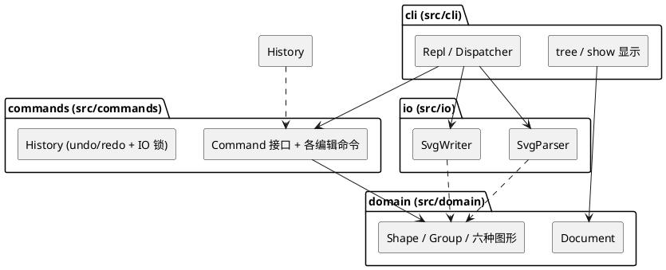

# Lab1 Phase 1：SVG 编辑器（CLI）— 设计文档

> 工程根目录：`lab1/`；运行方式：`npm install && npm run cli`。

## 架构方案

### 1. 模块划分

代码分为四个模块（`src/` 下四个目录），每个模块一类一文件：

| 模块 | 目录 | 职责 |
|---|---|---|
| 领域模型 | `src/domain/` | 内存中的图形树。`Shape` 抽象类统一叶子图形（rect / circle / ellipse / line / text）与容器 `Group`（Composite）；`Document` 持有画布尺寸、根容器与 id → 图形索引。几何语义（move 增量平移、scale 全几何等比、set 属性白名单校验）在这一层实现；图形级的序列化（`toSvg()`）与 tree 显示行（`summary()`）是图形自身的多态方法（理由见"变化点 1"）。 |
| 命令层 | `src/commands/` | 每条编辑命令是一个 `Command` 对象（`execute()` / `undo()`，返回值即回显文案）；`History` 维护 undo / redo 双栈与 IO 锁（文档类命令后禁止撤销，直至下一条编辑命令）。 |
| 文件读写 | `src/io/` | 文档级 XML 处理：`SvgParser` 把 SVG 文本解析成 domain 对象（缺 id 自动补号并警告），`SvgWriter` 负责文档头、嵌套与缩进、写文件。图形级序列化由图形多态方法提供，io 只做组装。 |
| 命令行界面 | `src/cli/` | REPL：逐行读取、分词（双引号参数、`#` 注释）、命令名 → 命令对象的分发、tree / show / help 显示、退出。是唯一接触终端的模块。 |

PlantUML 组件图：



### 2. 设计模式的选择

**Command（作业要求采用）**——"一条编辑命令 = 一个 undo 单元"天然适合命令模式：

- 接口 `Command { execute(): string; undo(): string }`，返回值即回显文案（如 `circle#c1 moved to (130,100)`），保证反馈与操作同源、undo 时能打印"还原到哪"；
- 每个命令对象自持逆操作所需信息（如 MoveCommand 记录目标 id 与增量），undo 无需全文档快照；
- 命令的**原子性**（"失败不改变任何状态"）在 execute 内先做全部校验、后变更来保证；
- `History` 双栈实现 undo / redo，新编辑后 redo 栈清空；文档类命令（init / read / save / canvas 改尺寸）置 IO 锁，编辑命令成功执行后清锁压栈。

落地：`src/commands/` 下 create / delete / move / scale / set / group / ungroup / addto / front / back 各一个命令类。

**Composite（容器与叶子统一操作）**——`Shape` 为抽象基类，`Group extends Shape` 持子节点列表；`move` / `scale` / `delete` / `set` 对容器递归生效、对叶子直接生效，命令层完全不区分两者。这正是"node2 下移 100 时文字随行"的机制，也是 `in` 子句、`group`、`addto` 三种归属写法共用同一套树操作的基础。

**工厂（名字分派点 ①，标注待重构）**——`create <type>` 的类型名 → 图形构造集中在 ShapeFactory 一处。待重构原因：插件化阶段将改为 ShapeProvider 注册表（box 等插件类型向注册表注册，内核按接口消费，届时内核零改动）。

**命令分发（名字分派点 ②，标注待重构）**——cli 的 Dispatcher 持命令名 → 命令构造的表。待重构原因：未来 agent / GUI 通道可直接构造 Command 对象复用命令层，分发表退化为 CLI 语法糖。

**有意不采用的模式**（记录取舍，避免模式堆砌）：

- **Visitor**：tree / show / 序列化确实需要"按图形类型给出表示"，但用 Shape 上的多态方法即可，且**新增图形类型是本工程最高概率的变化点（box 插件），而 Visitor 恰好对新元素类封闭**（每加一个图形类要改所有 Visitor 接口）——取舍后放弃 Visitor，让图形自己负责表示。
- **Memento**：命令自持逆信息已足够，全文档快照是浪费。
- **Singleton**：Document 由 main 显式创建并注入，无需全局单例。

### 3. 依赖方向规则

```
cli ──▶ commands ──▶ domain
cli ──▶ io ──▶ domain
cli ──▶ domain        （仅 tree/show 读取）
io   ✗ commands       （互不依赖）
domain ──▶ （不依赖任何业务模块）
```

| 规则 | 理由 |
|---|---|
| domain 不依赖任何业务模块 | 领域核心最稳定、被所有人依赖，必须零反向依赖 |
| commands 只依赖 domain | 命令是"对领域的操作"，不该知道文件格式或终端 |
| io 只依赖 domain | 读写是"文件格式 ↔ 领域对象"的翻译，与命令、终端无关 |
| io 与 commands 互不依赖 | 二者只通过 cli 间接协作，避免"读文件直接进历史栈"这类耦合 |
| cli 依赖全部、无人依赖 cli | cli 是最外层、最易替换的通道（未来 agent / 鼠标通道取而代之） |

违反上述规则的 import 即为待处理项（见"一致性自查"）。

### 4. 变化点假设

| # | 变化点（按概率排序） | 留了什么 / 为什么决定不留 |
|---|---|---|
| 1 | **新图形类型**（box 与插件生态，课业已明确预告） | 留：Shape 子类完全自治（自己的创建参数、序列化、tree 显示行），新增类型 = 新增子类 + 工厂一处登记；插件类型自带序列化即可即插即用。**不留** ShapeProvider 插件接口：本阶段只有六种内置类型，抽接口没有第二个实现，属过度设计；插件阶段引入时，工厂是唯一需要改动的位置。 |
| 2 | **新交互通道**（agent API、鼠标 GUI；规范已预告"三种通道"） | 留：命令层完全不接触终端（readline / process 只出现在 cli），GUI 可直接构造 Command 对象复用 undo / redo 全部逻辑。 |
| 3 | **序列化格式扩展**（transform 属性、更多 SVG 特性读回） | 留：文档级 XML 全部隔离在 io；图形级序列化在图形类自身，新增类型不需要改 io。 |
| 4 | **命令集增长** | 留：Command 接口与 History 的契约不变，加命令类即可。 |
| 5 | undo 策略演进（如合并连续 move） | **不留**：History 封装栈语义，外部只见 undo() / redo()，将来要改是内部实现问题；现在没有合并需求的证据。 |

### 补充约定（规格未明处的裁定记录）

规格存在若干未写死之处，实现前裁定如下（讨论背景见过程记录）：

| # | 场景 | 裁定 |
|---|---|---|
| D1 | undo 栈与 IO 锁的关系 | `init` / `read` 替换整个文档：**清空** undo / redo 栈并上锁；`save` / `canvas` 改尺寸只上锁不清栈（旧命令引用的图形对象仍有效）。锁持续到下一条成功执行的编辑命令。 |
| D2 | 读入时自动补 id 的序号 | 按"标签名 + 递增序号"生成，跳过与现存 id 冲突的号码 |
| D3 | 规格未定义退出命令 | 补充 `quit` / `exit`，Ctrl+D 亦可，help 中列出 |
| D4 | `save` 无参数且此前未 read 过文件 | 报 `error: no file specified` |
| D5 | 读入文件含重复 id | 保留首个，其余视为缺 id 自动补号并警告，不中断读入 |
| D6 | 含空格的参数 | 一律双引号包裹（含 `set` 的 text 值） |
| D7 | `group` 新容器的插入位置 | 成员从原父容器摘出后，新 g 插入到**第一个成员**在原父容器中的原位置（保持局部性） |
| D8 | `set` 作用于容器 g | g 无几何属性：白名单仅公共三项 fill / stroke / stroke-width，几何属性报 unknown attribute |
| D9 | `create` 参数个数 / 数字非法 | `error: wrong number of arguments for <type>: expected …, got …`；`error: invalid number: <raw>` |
| D10 | `scale` 作用于 text | 仅 x、y 参与缩放（font-size 不在 set 白名单内，不视为几何属性） |

---

## 过程记录

（待补：随开发推进累积，最终从过程笔记中提炼有代表性的讨论与迭代。）

## 一致性自查

（待实现完成后填写：实际目录与方案是否一致；依赖方向抽查结果。）

## 质量保证手段

（待实现完成后填写；计划：第 6 节两份完整会话的回放比对脚本 + 4.2 错误信息表逐条用例 + 核心模块单元测试。）
